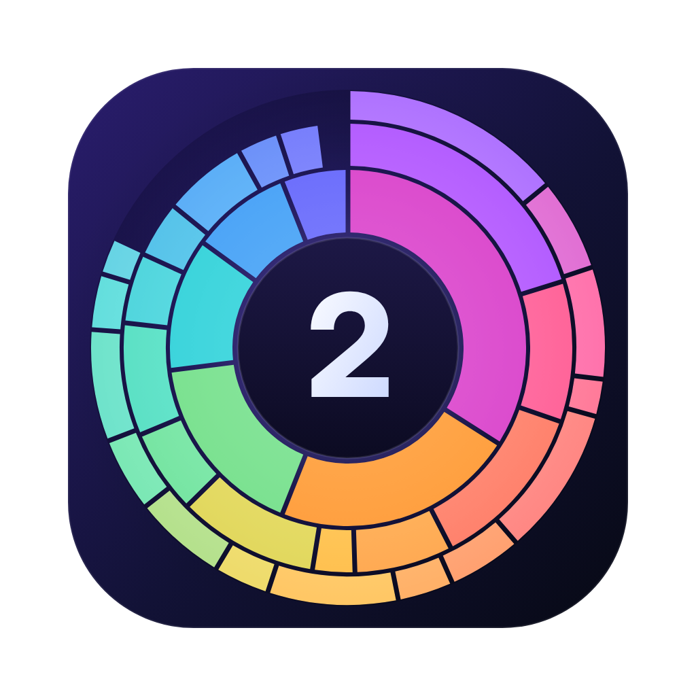
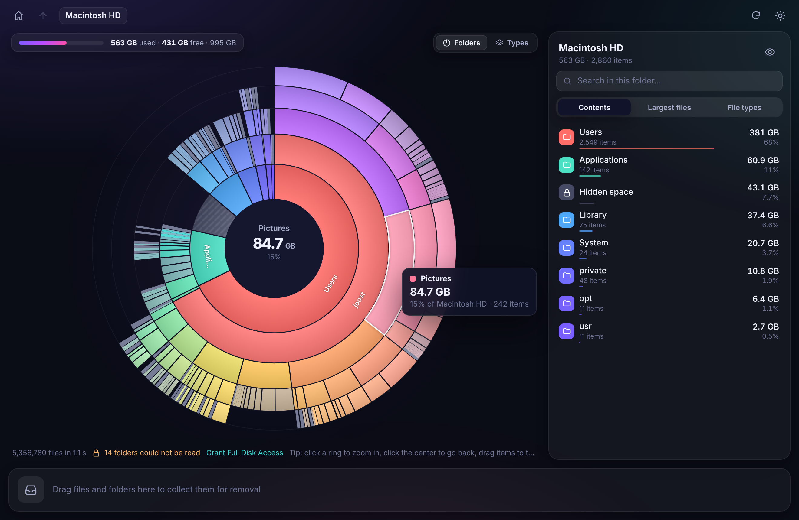
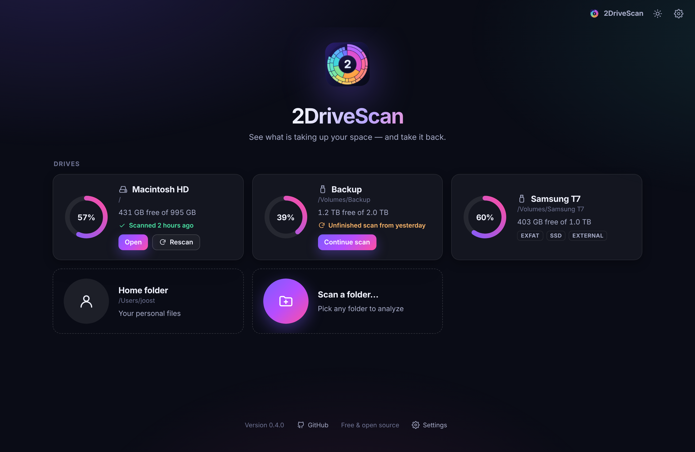

<p align="center">
  
</p>

<h1 align="center">2DriveScan</h1>

<p align="center">
  <b>See what is taking up your disk space, and take it back.</b><br/>
  A free, open source disk space analyzer for macOS, Windows and Linux.
</p>

<p align="center">
  <a href="https://github.com/joostiphone/2drivescan/releases/latest"><b>Download</b></a> ·
  <a href="https://2drivescan.app">2drivescan.app</a>
</p>



## Features

- **Interactive sunburst.** Every ring is a folder level. Hover to inspect, click to zoom in, click the
  center to go back. Transitions are animated so you never lose your place.
- **Fast.** A parallel scanner written in Rust reads hundreds of thousands of files per second. It counts the
  space files actually take on disk (sparse files and hard links are handled correctly) and stays on one volume.
- **Hidden space.** When you scan a whole drive, used space that no file accounts for (snapshots, swap, system
  files, folders you cannot read) is shown as its own segment, so the numbers add up.
- **Find the big stuff.** The side panel has a sorted folder list, the largest files anywhere below the
  current folder, a file type breakdown (video, images, archives, code…) and instant search.
- **Color by folder or by file type.** Switch modes to see at a glance what kind of data fills a folder.
- **Collector.** Drag items from the chart or the list into the Collector, review them, and move them to the
  Trash or Recycle Bin in one go. Nothing is ever deleted permanently, so you can always restore items.
- **Native everywhere.** Light and dark mode, English and Dutch, reveal in Finder, Explorer or your file
  manager, and keyboard shortcuts.


## Download



Get the latest installers from the [Releases page](https://github.com/joostiphone/2drivescan/releases/latest):

| Platform | Installer |
| --- | --- |
| macOS 10.15+ (Apple Silicon & Intel) | `.dmg` (universal) |
| Windows 10/11 (x64, ARM64) | `-setup.exe` (or `.msi` for x64) |
| Debian, Ubuntu, Mint, Pop!_OS | `.deb` (amd64, arm64) |
| Fedora, openSUSE, RHEL | `.rpm` (x86_64, aarch64) |
| Any other distribution | `.AppImage` (amd64, aarch64) |

> **macOS:** grant 2DriveScan **Full Disk Access** in *System Settings → Privacy & Security* for a complete scan.
> If macOS refuses to open an unsigned build, click **Open Anyway** in the same settings pane.

## Keyboard shortcuts

| Action | Shortcut |
| --- | --- |
| Go up one level | `Esc`, `Backspace` or `Alt + ↑` |
| Search in the current folder | `/` or `Ctrl/⌘ + F` |
| Rescan | `Ctrl/⌘ + R` |

## Development

2DriveScan is a [Tauri 2](https://tauri.app) app: the scanner and system integration are written in Rust,
and the interface is plain HTML, CSS and JavaScript (no bundler) rendered on a canvas.

```
crates/scan-core   Parallel scanner and tree model (pure Rust, unit tested)
src-tauri          Desktop app: commands, volumes, trash, packaging config
ui                 Interface (index.html, css/, js/). js/mock.js is a demo backend
scripts            Preview server and version bump helper
website            Laravel site for 2drivescan.app (see website/README.md)
assets             Icon source (make_icon.py renders icon.svg)
```

Requirements: Rust (stable), Node.js 18+, and on Linux the
[Tauri system dependencies](https://tauri.app/start/prerequisites/#linux).

```bash
npm install
npm run dev          # run the app with live reload
npm run build        # build installers for the current platform
npm run preview      # open the UI in a normal browser with sample data (http://localhost:5173)
cargo test --workspace
```

Try the scanner without the UI:

```bash
cargo run --release -p scan-core --example bench -- ~/Downloads
```

### Releasing

1. `node scripts/bump-version.mjs 0.2.0`
2. Commit, then tag and push: `git tag v0.2.0 && git push origin main v0.2.0`
3. The [Release workflow](.github/workflows/release.yml) builds all installers on GitHub Actions, attaches them
   to a new GitHub release and publishes it when every platform succeeds.

Code signing is optional. To sign and notarize the macOS app, follow [docs/macos-signing.md](docs/macos-signing.md).

## License

[MIT](LICENSE)
